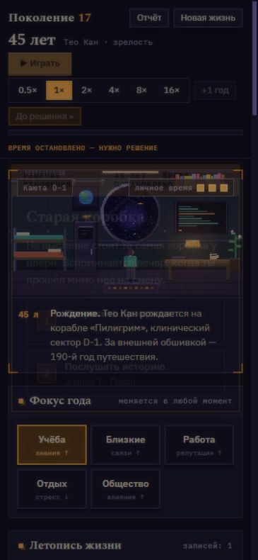

# Content Language v2 & Decision Memory — итог этапа

> **Исторический отчёт о реализации от 29.10.2026.** Описывает ветку `claude/content-language-v2`, базу `c381176` и реализацию `84184c0`. На момент подготовки ветка ещё не была слита; после этого реализация вошла в `main` (merge `a5f525c`). Этот документ сохраняет исходные результаты и методику, а актуальный контракт описан в [CONTENT_LANGUAGE_V2.md](CONTENT_LANGUAGE_V2.md) и [content/README.md](../content/README.md).

## Результат и архитектура

Одна JSON-сцена теперь меняет основной текст, видимые ответы, результат и
последствия по реально принятому прошлому решению. Полный контракт:
[CONTENT_LANGUAGE_V2.md](CONTENT_LANGUAGE_V2.md). Руководства авторов обновлены в
[README](../content/README.md) и [STYLE](../content/STYLE.md).

Добавлены:

- стабильные `choices[].id`, смысловой API `decideById` и проверка дубликатов;
- `GameState.decisions: { id, choice, age, epilogue?, legacy? }[]`;
- общий Requires у ответов, скрытие невозможных ответов и доменные проверки
  повторного вызова, денег, времени и настоящих покупок;
- `bodyVariants`, `resultVariants`, `textVariants`, варианты результата момента
  и исходов навыка; первая подходящая альтернатива, затем базовая строка;
- `any`, `seen`, `notSeen`, `chose`, `decisionYears`, `bond`, `skill`, `ship`,
  `birthWealth`, `trait`, `dead`, `absent`, `exists`;
- JSON-реестры линий и категорий, прежние forks и панель «Развилки»;
- tone с приоритетом над прежними TONE_OVERRIDES, нормализованные tags/group;
- фиксируемый при принятии решения эпилог, без создания полной хроники;
- общий реестр меток людей, включая исправленную охрану sibling и новую parent2.

Сохранены flags, seen, forks, history, memories, экономика T8 и личное время T9.
Условия/тексты не расходуют RNG. Варианты результата и исходов навыка выбираются
**до эффектов**; имена результата подставляются на прежней фазе после эффектов,
что сохраняет addPerson ребёнка. Эпилог целиком подставляется и сохраняется до
эффектов, поэтому поздняя смена имени, пола или смерть NPC не меняет факт.

Проверки компилируются один раз, включая таблицы сравнений. chose читает небольшой
журнал линейно: измерения не показали необходимости отдельного индекса/кэша.
Глубина any ограничена восемью уровнями, массив альтернатив — 32 элементами.
Нет произвольного JS, циклов, формул или универсального expression engine.

Для новых пакетов ID ответов обязательны. Прежние 41 JSON-событие явно перечислены
в compatibility.json; их варианты, как старый TS-контент, могут пока не иметь ID.
В журнале такой выбор обозначается `legacy-index:N`, `legacy: true`, и не считается
стабильной ссылкой для chose. Новый автор не должен добавлять себя в исключения.

JSON-линия объявляется `{ id, title, start }`, начало имеет arc и fork: true,
продолжения — тот же arc. Категория объявляется `{ id, title }`: директор сравнивает
ID, окно показывает title. Неизвестные исторические ID и снимки forks сохраняются
после удаления деклараций. Новая параллельная система развилок не создана.

## Сохранения и защита от тупиков

Версия контейнера сохранения остаётся 2. repairSave явно добавляет старой жизни
пустой журнал; ничего не восстанавливает из флагов, показов или текста хроники.
Повреждённые, повторные и будущие записи удаляются, исторические неизвестные ID
сохраняются. Повторная загрузка идемпотентна.

Проверены сохранения до журнала, начатый «Сосед», pending начала и продолжений,
старый fork, загрузка после начала и продолжение только по старым флагам,
повторная загрузка, состояния экономики и времени. Старые эталоны T6/T9 проходят
при восстановлении прежнего порядка каталога в тестах.

Каждому новому событию валидатор требует безусловный выход без покупки и денежных
изменений, включая обе ветви навыка. Деньги и время остаются видимыми причинами
блокировки; биографические ограничения скрывают ответ. canChoose/decide повторяют
проверки. tick не выбирает событие без доступного выхода; неразрешимый старый
pending снимается с записью без эффекта, расхода или выдуманного решения.

UI работает с исходными индексами через visibleChoiceIndices, отдельно нумеруя
видимые ответы. Горячие клавиши вызывают chooseVisible. В «другие пути» новой
развилки записываются только действительно видимые в момент решения варианты.

## «Сосед»: перенос и эквивалентность

Перенесены **8 событий, 23 ответа**: одно начало и семь продолжений. Единственная
активная реализация находится в [neighbor.json](../content/storylets/neighbor.json).
Эталонный TS живёт только в тестовой фикстуре, не в каталоге игры.

До изменений движка снят неизменяемый эталон `c381176`: **200 seed × 4 стратегии =
800 жизней**, 83 288 состояний и 4 018 диагностических непосредственных исходов.
Сохранены реальный снимок каждой стадии и прежний порядок каталога.

После переноса:

- 666 304 сравнения условий старой и новой реализации — без расхождений;
- 4 012 исходов, для которых исходная сцена действительно могла показываться,
  сравнены на тех же состояниях — без расхождений во всех прежних полях состояния;
- шесть принудительных вызовов из диагностической выборки имели отсутствующего
  в активном тексте соседа: исходный tick тоже не показывал бы такие сцены, поэтому
  они не используются как эталон доступного игроку исхода;
- совпали окна, приоритеты, веса, строки, исходный порядок/состав ответов, показатели,
  флаги, связи, воспоминания, покупки/время и состояние forks;
- совпал предмиграционный SHA-256 replay:
  `75682c15ae3d155b95c210da922035deb8ea0c779a4b4df834f499b3ef7cc6e7`;
- весь набор встреченных событий frozen-каталога совпал с эталоном, включая редкий
  crack-worsened. Старый эталон не перезаписывается даже при повторном запуске
  диагностического скрипта с --capture.

Старые веса 12–18 сохранены в явном списке совместимости. Они не превращаются
в приоритет: семантика followup прежняя. Семантический порядок ID в политиках
ботов сохранён, поэтому перестановка массива ответов не меняет смысл их решения.

## Аудит полных жизней

Выборка: 1 200 жизней, шесть стратегий × 200 seed 3001–3200, плюс 150 жизней с
другими ответами. База — сохранённый [исходный аудит](audit/core-systems-variety.json),
подтверждённый прогоном до правок; новые данные —
[content-v2-after.json](audit/content-v2-after.json),
[сводное сравнение](audit/content-v2-comparison.json). Старые аудиты не изменялись.

| Показатель | До | После |
|---|---:|---:|
| Решений за жизнь, среднее | 25,0 | 25,1 |
| Доставка доступных followup | 99,7% | 99,8% |
| Доставка critical | 100% | 100% |
| Не встретившихся событий | 1 | 2 |
| Долгоживущих forks без исхода, кроме самостоятельного career | 36 | 38 |
| «Сосед»: таких forks / долгоживущих | 1 / 531 | 4 / 537 |
| Нарушений инвариантов | 0 | 0 |
| Средний размер финального сохранения, КБ | 97,2 | 99,3 |

У «Соседа» доставка neighbor-followup стала 99,0%, neighbor-kid-moved — 97,2%,
остальных пяти продолжений — 100%. Начало показано в 46,3% жизней против 45,5%.
Это не заявление о полной тождественности жизней: перемещение восьми событий из TS
в JSON меняет порядок взвешенного выбора и дальнейший RNG. Тождественность самой
миграции доказывается на одинаковых состояниях выше.

После переноса в данной выборке не встретились census-counting-voice и
crack-worsened; до переноса не встречался только первый. «Не встретился» не означает
«недостижим»: crack-worsened по-прежнему доставлен в replay старого каталога,
а сам он не менялся. Это отделено от проверки доступности языка.

Метрика arcsWithoutOutcome считает самостоятельный career незавершённым во всех
1 164 случаях и до, и после; поэтому выше приведена также содержательная метрика
без этого односценного arc. Новый баланс директора в этом этапе не вводился.

## Проверки и производительность

- npm run content — 49 JSON-сюжетов, 56 JSON-моментов, 0 предупреждений.
- npm run content:check — 14 файлов, без ошибок.
- npm run typecheck — успешно.
- npm test — **41 файл, 1 000 тестов**, все проходят (было 874).
- Дополнительный усиленный replay переноса — 31 тест, все проходят.
- npm run build — успешно; JS 632,02 КБ, gzip 186,35 КБ. Vite сообщает обычное
  предупреждение о чанке больше 500 КБ; разбиение приложения в этап не входило.
- npm run sim -- 100 — **700 полных прогонов** семи стратегий, inconsistencies = {}.
- audit:variety — результаты выше, 0 нарушений инвариантов.
- git diff --check — успешно.

[Нагрузочный опыт](audit/content-v2-performance.json): 1 500 событий, варианты body
и результатов, журнал из 101 записи. Медиана из пяти измерений после прогрева:

| Операция | Стоимость |
|---|---:|
| Условие диапазон + OR | 84 нс |
| chose + decisionYears, совпадение в конце журнала | 873 нс |
| Выбор первой подходящей альтернативы body | 1,497 мкс |
| Полный проход 1 500 событий с условиями и текстами | 9,60 мс |
| Изменение heap при компиляции каталога | 17,88 МБ |

Это небольшой локальный microbenchmark на Node 22 / Windows x64, не обещание
частоты кадров на всех устройствах. Delta heap включает обычный шум выделений и
GC. Состояние и RNG до/после совпадают; сложные кэши не добавлялись.

## Проверка интерфейса

Проверена настоящая DecisionModal в локальном приложении, не отдельная имитация.
Воспроизведение: запустить Vite и открыть scripts/content-v2-preview.html с
`?past=help`, `?past=refuse` либо `?past=unseen`; `&paid` включает тест нехватки денег.
Фикстура не добавлена в производственный bundle.

| Размер | Сценарий | Результат |
|---|---|---|
| 375 × 812 | Ранее отказал | Два ответа 1–2; скрытого первого исходного ответа нет; клавиша 1 реально приняла apologize |
| 768 × 1024 | Ранее помог, не хватает 1 кр. | Платный ответ виден и disabled, причина показана, бесплатный выход доступен |
| 1440 × 900 | Не участвовал | Базовый текст и один видимый ответ с номером 1 |

Переполнения диалога по горизонтали нет: clientWidth = scrollWidth (329 / 636 /
636 px). DOM всего окна также помещается в каждый viewport. Отдельные SSR/Pinia
тесты проверяют панель «Развилки», исходные индексы, блокировки денег/времени,
скрытые прямые вызовы, повтор клавиши и результаты.



[768 px](audit/content-v2-ui-768.png) · [1440 px](audit/content-v2-ui-1440.png)

## Оставшиеся ограничения и следующие этапы

1. **Можно ли писать сотни вариативных событий без TS?** Да, в рамках имеющихся
   условий, эффектов, профессий, предметов и ролей людей. Новая линия/категория,
   отсылка к реальному решению, иной текст и условный ответ больше не требуют TS.
2. **Что ещё требует TS?** Принципиально новый вид эффекта/механики, произвольные
   вычисления, новые роли/источники NPC и их самостоятельная жизнь. Нет сравнений
   произвольных полей между собой, формул, циклов, операций над произвольным графом.
3. **Достаточно ли для значимых NPC?** Достаточно как основы причинного повествования:
   ссылка на человека, известность/жизнь/смерть, связь, прошлые решения. Полная модель
   личности и самостоятельных событий этим не реализована.
4. **Что нужно от «Людей как данных»?** Устойчивые ID людей отдельно от ролей,
   декларативный реестр, даты появления/ухода/смерти, доступность, отношения,
   состояния, профессия и место. Сегодня реестр содержит семь фиксированных ролей;
   его источник затем нужно заменить данными. Нельзя приравнивать уход к смерти.
5. **Что получит будущий директор?** tone, tags, group, arc/fork, category,
   priority, возрастные окна/expiry и реальную историю решений с возрастами.
   Группы пока не запрещают второй сюжет и теги не меняют вероятность.
6. **Что добавить в QA контента?** Проверки значений и владельцев флагов,
   пространств ID, графа обещаний и порогов доставки, достижимости всех веток,
   противоречащих фактов эпилога, литературных повторов и достоверности отсылок.
   Новый валидатор уже ловит форму, неизвестные ссылки/ответы, дубликаты,
   некорректные диапазоны, метки без гарантий, глубину и отсутствие свободного выхода;
   литературную правдивость автоматическая проверка не доказывает.

Ни экономика, ни личное время, ни новые механики NPC/директора не добавлялись.
Изменения старых тестовых сценариев ограничены новыми ID, действительным наличием
сестры, учётом отдельного storySpent и воспроизведением прежнего порядка каталога.
Исторические отчёты T6–T9 сохранены. Посторонние десять неотслеживаемых файлов не
добавлялись и не изменялись. Изменения собраны в два коммита: цельная реализация с
тестами, затем итоговые аудитные артефакты и отчёт.

## Полный пример одной истории

Это одна история из двух JSON-событий; копий возвращения под каждую биографию нет.
При help показаны благодарный body, remember и listen; при refuse — другой body,
apologize и listen; без участия — базовый body и только listen. Общий listen тоже
имеет три результата. У remember, apologize и listen разные эффекты и флаг исхода.
Фикстура исполняется обычным compileStorylet/decide без отдельного TS-сюжета.

```json
[
  {
    "id": "archive-help", "category": "Отношения", "title": "Коробка у двери",
    "body": "В коридоре стоит коробка старых записей. Знакомый просит помочь отнести её в архив, но твоя смена скоро начинается.",
    "min": 18, "max": 30, "weight": 2,
    "choices": [
      { "id": "help", "text": "Помочь с коробкой", "hint": "Связи ↑ · Стресс ↑", "result": "Вы успеваете до закрытия архива. Знакомый запоминает этот вечер.", "effects": { "stats": { "bonds": 3, "stress": 2 } }, "epilogue": "Помог{{hero:|ла}} знакомому сохранить старые записи." },
      { "id": "refuse", "text": "Пойти на смену", "hint": "Покой · Дистанция", "result": "Ты спешишь на смену. Коробка остаётся у двери до следующего утра.", "effects": { "stats": { "stress": -1 } } }
    ]
  },
  {
    "id": "archive-return", "category": "Отношения", "title": "Старая коробка",
    "body": "В галерее открылась выставка старых записей. На снимке знакомая коробка, но её историю ты слышишь впервые.",
    "bodyVariants": [
      { "requires": { "chose": { "archive-help": ["help"] } }, "text": "На выставке ты узнаёшь коробку, которую помог{{hero:|ла}} донести в архив. У витрины тебя встречают улыбкой." },
      { "requires": { "chose": { "archive-help": ["refuse"] } }, "text": "На выставке стоит та самая коробка у двери. Вспоминается вечер, когда ты прош{{hero:ёл|ла}} мимо неё на смену." }
    ],
    "min": 40, "max": 65, "weight": 2, "tone": "warm", "tags": ["memory", "community"], "group": "archive-reunion",
    "choices": [
      { "id": "remember", "text": "Вспомнить тот вечер", "hint": "Связи ↑", "requires": { "chose": { "archive-help": ["help"] } }, "result": "Вы вспоминаете дорогу по коридору и смеётесь над тем, как тяжела была коробка.", "effects": { "stats": { "bonds": 4, "morale": 2 }, "flags": { "archiveReunion": "shared" } } },
      { "id": "apologize", "text": "Попросить прощения", "hint": "Связи ↑ · Стресс ↑", "requires": { "chose": { "archive-help": ["refuse"] } }, "result": "Разговор даётся нелегко, но теперь между вами не остаётся того молчания.", "effects": { "stats": { "bonds": 2, "stress": 2 }, "flags": { "archiveReunion": "reconciled" } } },
      { "id": "listen", "text": "Послушать историю", "hint": "Знания ↑ · Покой",
        "result": "Ты слушаешь рассказ о коробке. История впервые становится частью твоей жизни.",
        "resultVariants": [
          { "requires": { "chose": { "archive-help": ["help"] } }, "text": "Рассказчик упоминает твою помощь. Ты замечаешь, сколько чужих воспоминаний начинается с одного вечера." },
          { "requires": { "chose": { "archive-help": ["refuse"] } }, "text": "Ты узнаёшь, кто всё-таки донёс коробку. Чужая доброта позволила этим записям дожить до выставки." }
        ],
        "effects": { "stats": { "knowledge": 2, "stress": -1 }, "flags": { "archiveReunion": "listened" } }
      }
    ]
  }
]
```
