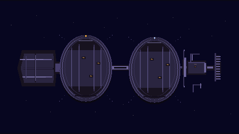
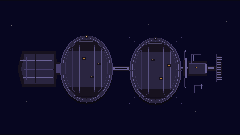

# GEN-78: F3 внешний вид «Пилигрима»

Запустите предпросмотр из корня проекта:

```sh
npm install
npm run dev
```

Откройте `http://localhost:5173/pilgrim-preview.html`. Страница рендерит исходную сцену процедурными пиксельными примитивами в Canvas 480×270 и показывает уменьшенный вариант в отдельном Canvas 240×135. Ссылки рядом с обоими размерами сохраняют PNG. Страница автономна и не подключена к игровой сцене или навигации.

Метки на ободах движутся в противоположные стороны с декоративным циклом 8 секунд; малый кормовой индикатор слегка меняет яркость. Переключатель выключает оба движения. Также учитывается системная настройка reduced motion, а при скрытии вкладки цикл приостанавливается.

## Ограничения прототипа

- F3 — концепт, не утверждённый облик и не каноническая карта.
- Детали не обозначают секторы, координаты, текущий адрес, реальные скорости, искусственную гравитацию или работу двигателя.
- Реальные снимки Canvas после браузерной проверки: [480×270](images/pilgrim-f3-480x270.png) и [240×135](images/pilgrim-f3-240x135.png).




