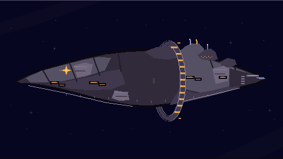
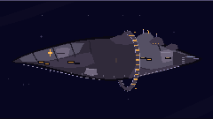

# GEN-81 · Пилигрим A+C Refined v2.0

## Запуск

Из корня проекта:

```sh
npm install
npm run dev
```

Откройте `http://localhost:5173/pilgrim-v2-preview.html`. Предпросмотр изолирован от игровой сцены и навигации. Основной Canvas — 480×270; справа показан отдельный Canvas 240×135. У обоих есть ссылка для скачивания PNG.

## Прочтение формы

Один защищённый асимметричный корпус идёт от широкой носовой массы слева к компактной технической корме справа. Крупное встроенное кольцо — единственный главный графический якорь, вокруг него видны непрерывные слои корпуса. Ступени сверху собраны в жилую и навигационную надстройку. Эмблема миссии и несколько закрытых тёплых ниш показывают предназначение и обитаемость; надписей на корпусе нет, оболочка остаётся в основном непрозрачной. Кормовой холодный отблеск декоративный и не обозначает состояние двигателя.

Кодовая геометрия намеренно крупнее и проще исходного высокодетализированного изображения: вместо копирования каждой плиты она сохраняет пропорции длинного защищённого корпуса, характерный профиль A+C и читаемое кольцо. F3 с двумя отдельными барабанами здесь не используется.

## Снимки реального Canvas

Оба PNG получены из работающих Canvas предпросмотра, а не нарисованы отдельно. Миниатюра — самостоятельный Canvas 240×135 с отключённым сглаживанием.

### Основной Canvas · 480×270



### Проверка силуэта · 240×135


